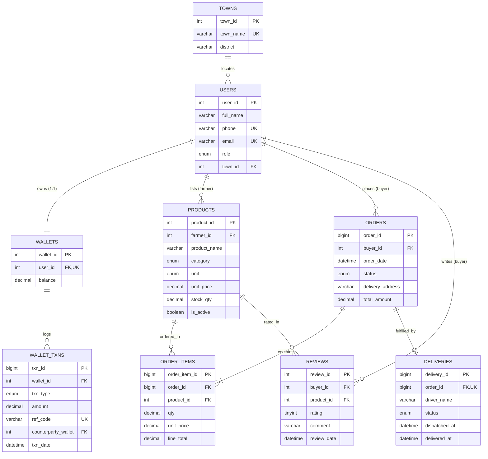

# AgriConnect: Farm-to-Market Platform with Mobile Money Wallet
## Phase 1: Entity-Relationship (ER) Modeling & Conceptual Design

---

### 1. Conceptual Entity Catalog

The AgriConnect conceptual model consists of 9 core entities:

1. **`TOWNS` (Strong Entity):**
   Geographical lookup containing market centers, municipalities, and districts across Uganda.
2. **`USERS` (Strong Entity):**
   System actors categorized into roles: `FARMER`, `BUYER`, or `BOTH`.
3. **`WALLETS` (Strong / Complement Entity):**
   Digital ledger account maintained in a strict 1:1 relationship with each user.
4. **`WALLET_TXNS` (Weak Entity):**
   Immutable log of monetary movements. Existence-dependent on `WALLETS` (foreign key `wallet_id`).
5. **`PRODUCTS` (Strong Entity):**
   Produce items listed for sale by farmers.
6. **`ORDERS` (Strong Entity):**
   Commercial orders placed by buyers.
7. **`ORDER_ITEMS` (Weak Entity / Junction Entity):**
   Individual line items within an order. Resolves the $M:N$ relationship between `ORDERS` and `PRODUCTS`.
8. **`DELIVERIES` (Dependent Entity):**
   Logistics shipment status linked in a 1:0..1 relationship to an `ORDER`.
9. **`REVIEWS` (Associative Entity):**
   Buyer product feedback and ratings (1 to 5). Resolves the $M:N$ feedback relationship between `USERS` and `PRODUCTS`.

---

### 2. Relationship Cardinality Matrix

| Relationship | Cardinality | Dependency Type | Notes & Integrity Constraints |
| :--- | :--- | :--- | :--- |
| **`TOWN` — `USERS`** | $1 : M$ | Independent | A town hosts multiple users; each user belongs to exactly one town. |
| **`USER` (Farmer) — `PRODUCTS`** | $1 : M$ | Independent | A farmer lists 0 or more products; each product belongs to one farmer. |
| **`USER` — `WALLET`** | $1 : 1$ | Strong (Shared Identity) | Every user must have exactly 1 wallet (`wallets.user_id UNIQUE`). |
| **`WALLET` — `WALLET_TXNS`** | $1 : M$ | **Weak Entity** | A wallet possesses many transaction records. Existence-dependent on wallet. |
| **`USER` (Buyer) — `ORDERS`** | $1 : M$ | Independent | A buyer initiates 0 or more orders; an order belongs to 1 buyer. |
| **`ORDER` — `ORDER_ITEMS`** | $1 : M$ | **Weak Entity** | Line items cannot exist without an order master record (`ON DELETE CASCADE`). |
| **`PRODUCT` — `ORDER_ITEMS`** | $1 : M$ | Resolution of $M:N$ | A product appears across many order items. Price is historical snapshot. |
| **`ORDER` — `DELIVERY`** | $1 : 0..1$ | Dependent | Every order has at most 1 delivery record (`order_id UNIQUE`). |
| **`USER` — `REVIEWS` — `PRODUCT`** | $M : N$ | Associative Entity | Resolved via `REVIEWS` with a composite unique key `(buyer_id, product_id)`. |

---

### 3. Entity-Relationship Diagram (Mermaid)

---

### 4. Weak Entity Justification

- **`ORDER_ITEMS`:** Cannot exist independently of an `ORDERS` master header row. If an order is discarded prior to completion, its items possess no conceptual meaning.
- **`WALLET_TXNS`:** Represents an atomic audit event strictly belonging to an underlying `WALLETS` balance account. It cannot be instantiated without a valid parent wallet.
